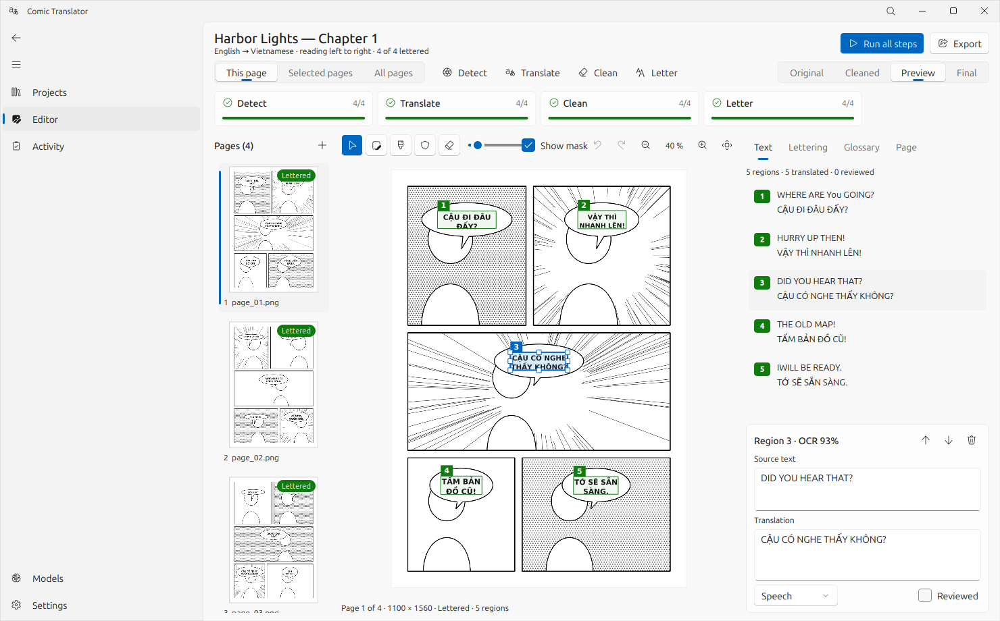
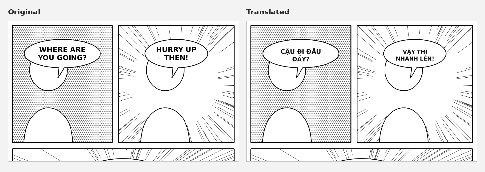
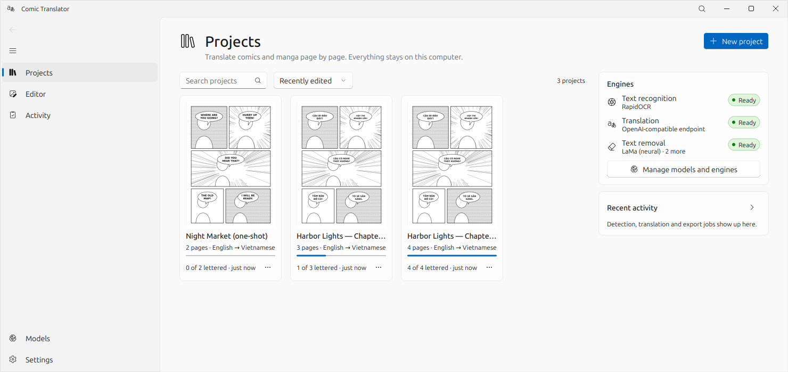
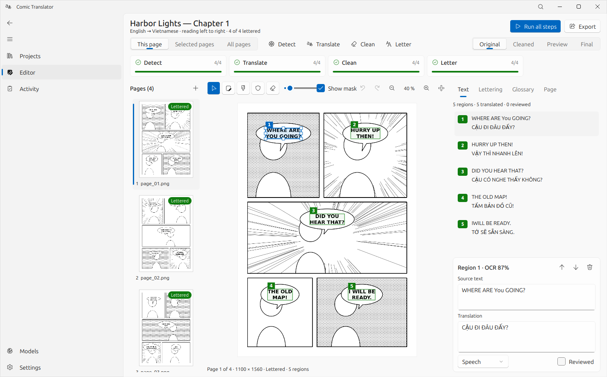
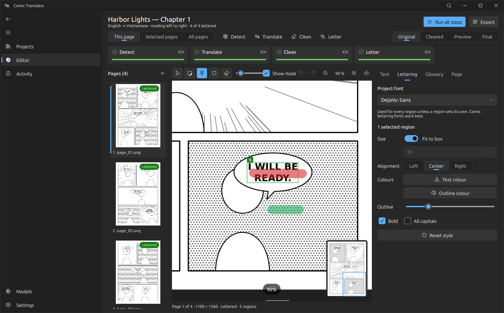
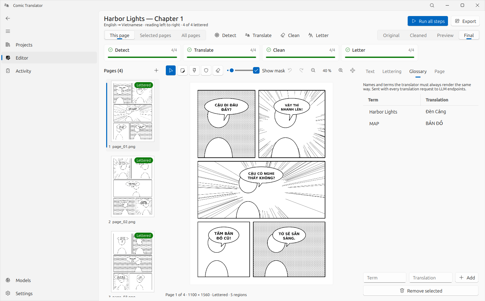
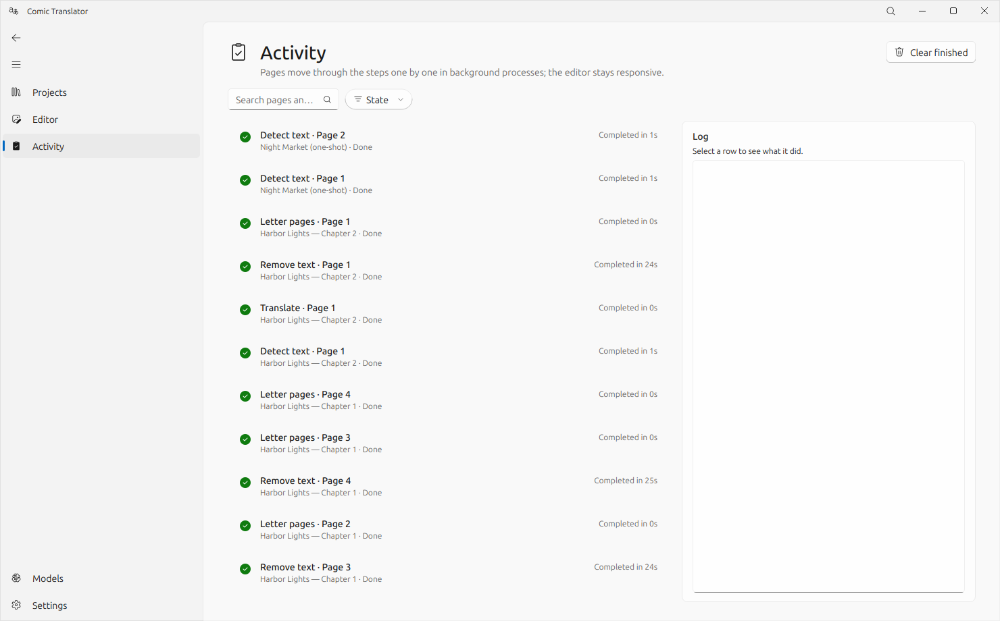
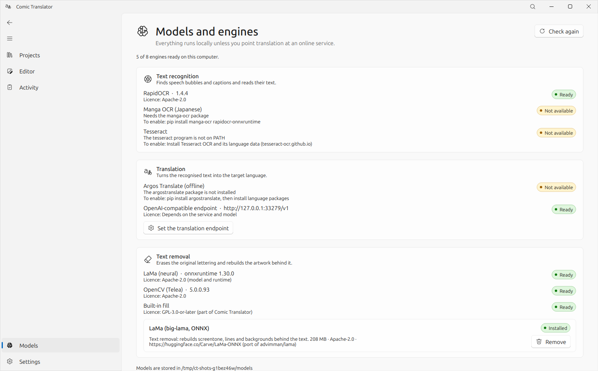
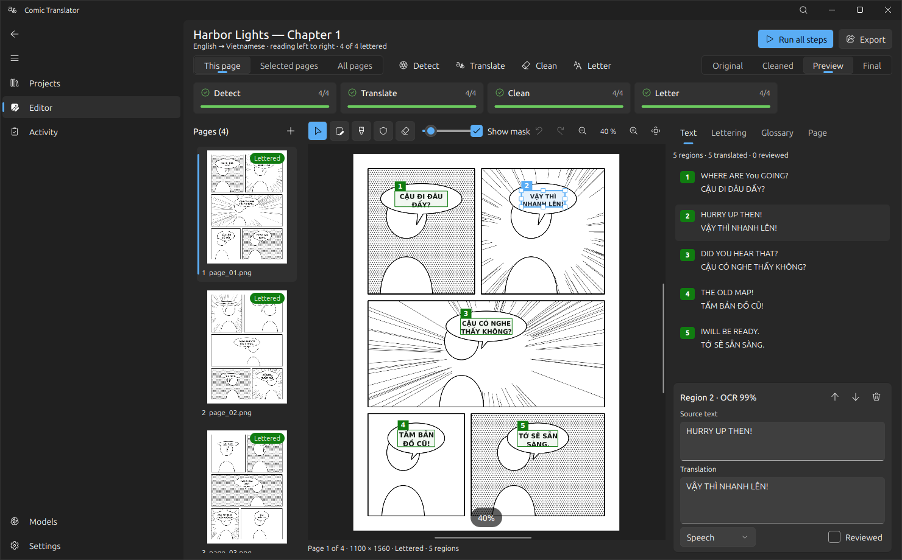

# Comic Translator

**Translate comics and manga on your own computer.** Comic Translator finds the speech balloons, reads the text,
translates it, removes the original lettering from the artwork and letters the translation back in, with review and
correction at every step, page by page. Built with [FluentQt](https://github.com/pntrungbk15/fluentqt-showcase) on PyQt5.


> **About this repository.** It presents Comic Translator through screenshots and a written overview. It contains no
> source code: the application's source is private at this stage. The comic in the screenshots is drawn by the
> project's own generator; no third-party artwork is shown.





## The workflow

```
Import ─▶ Detect ─▶ Translate ─▶ Clean ─▶ Letter ─▶ Export
pages     OCR +     LLM or       remove    fit the      PNG / JPEG / WebP,
CBZ/ZIP   regions   Argos, with  text,     translation  CBZ, and text
folders             glossary     rebuild   in each      layers
                                 artwork   balloon
                 ▲ review and correct at every step: regions, text, masks, lettering ▲
```

Pages flow through the steps **independently**: the first page is lettered and ready to proofread while later pages are
still being read. Only what an edit affects runs again: changing a translation re-letters that page without cleaning it
again; repainting a mask cleans it again, then re-letters it.

| At a glance | |
|---|---|
| **Text detection and OCR** | RapidOCR (detection and recognition), Manga OCR for Japanese including vertical text, or Tesseract; lines grouped into balloon-sized regions in reading order (right to left for manga). |
| **Translation** | Any OpenAI-compatible endpoint (Ollama, LM Studio, llama.cpp or a hosted API) or offline Argos Translate. One request per page, with the previous page's lines as context and a project glossary of names and terms. |
| **Text removal** | Text pixels found inside each region and filled by LaMa (neural, ONNX Runtime), OpenCV Telea or a built-in fill; mask painting to remove or protect artwork. |
| **Lettering** | The translation fitted into the free space of each balloon, with fonts, sizing, alignment, colours and outline per project or per region. |
| **Background work** | Detection, text removal and lettering run in warm worker processes (a model loads once per session); pause, resume, cancel, retry failed pages only; unfinished jobs reported after a crash. |
| **Proofreading and editing** | OCR confidence flags, reviewed marks, region drawing and reordering, undo/redo for every edit, autosave. |

## Screens

| | |
|---|---|
|  |  |
| **Projects:** covers, progress and engine status. | **Review:** numbered regions on the original page, source and translation side by side. |
|  |  |
| **Mask painting:** red marks text to remove, green protects artwork. | **Final:** the lettered page, with the project glossary open. |
|  |  |
| **Activity:** every page step with its state and duration, retry, and a log per task. | **Models:** which engines run on this computer and what each needs. |



## Architecture

```
flow          one task per page and step, dependencies, warm stage workers, pause/cancel/retry
pipeline      the steps: what each needs, its input fingerprint, and how its result is stored
jobs/         one-off jobs (export, downloads, probes) and the worker process
engines/      OCR, translation, inpainting, model downloads (imported only by workers)
canvas/       the page editor: regions, masks, lettering preview, undo
typeset       balloon lettering, shared by the preview and the export
storage/      schema and repositories (projects, pages, regions, glossary, jobs, models)
```

The GUI process never imports an OCR or inference runtime; engines live only in worker processes, so the editor starts
and works even when no engine is installed.

## Performance

Measured with the project's benchmark script:

| Measurement | Result |
|---|---|
| Open a 3000 × 4254 page | 160 ms |
| Import a 200-page CBZ | 79 ms, worst GUI stall 12.5 ms |
| 8 pages, RapidOCR + LaMa on CPU: first page lettered | **38 s** with the page flow (194 s when every step finishes for all pages first) |
| 8 pages: all done | 188 s; worst GUI stall 22 ms |

## Author

Phạm Ngọc Trung · [github.com/pntrungbk15](https://github.com/pntrungbk15)

All screenshots © Phạm Ngọc Trung. Shown here for portfolio purposes; no licence to the software is granted by this
repository.
