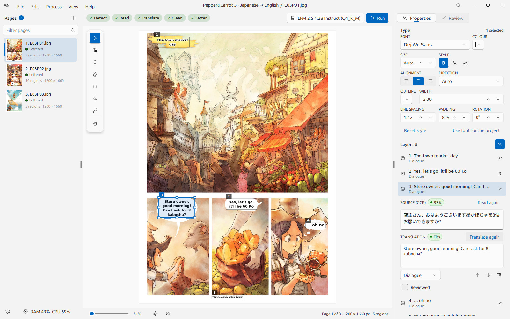
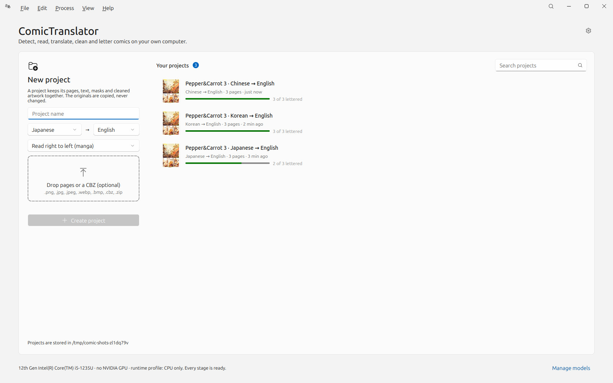
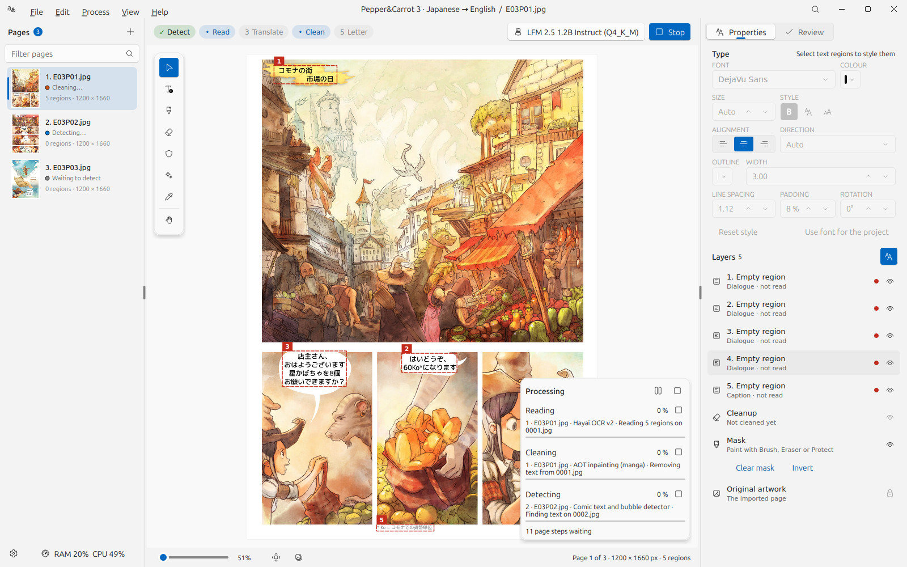
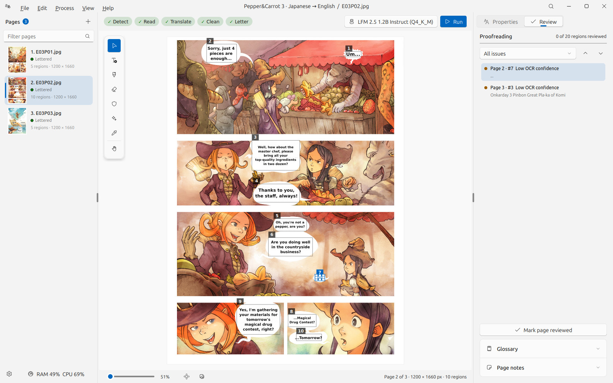
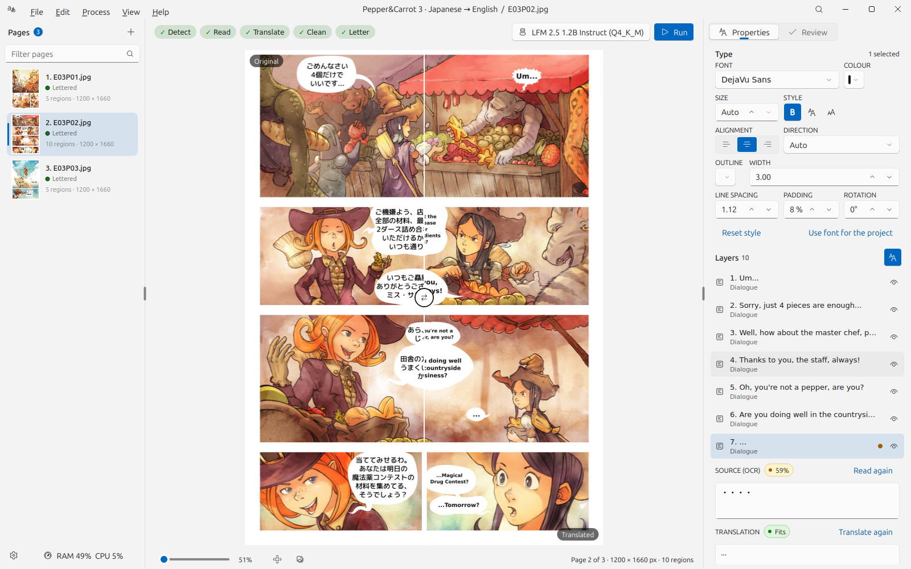
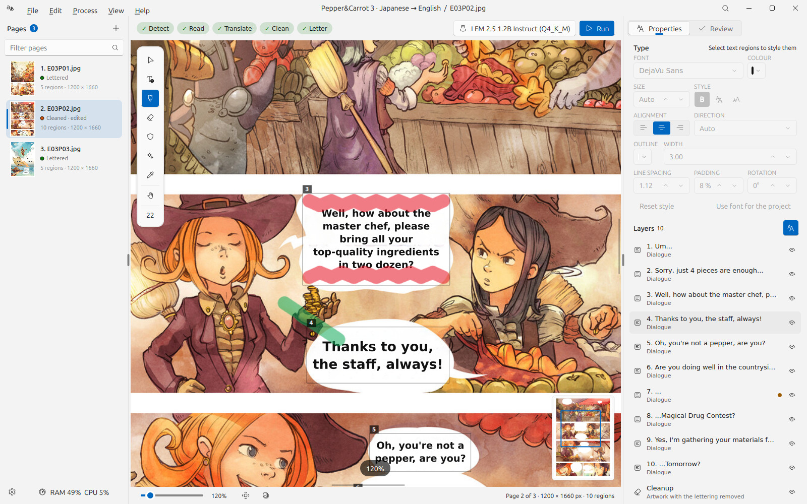
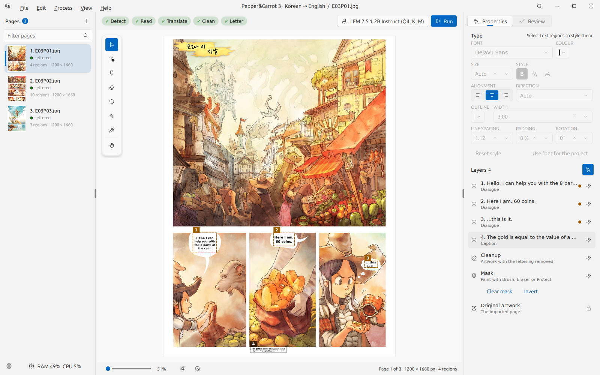
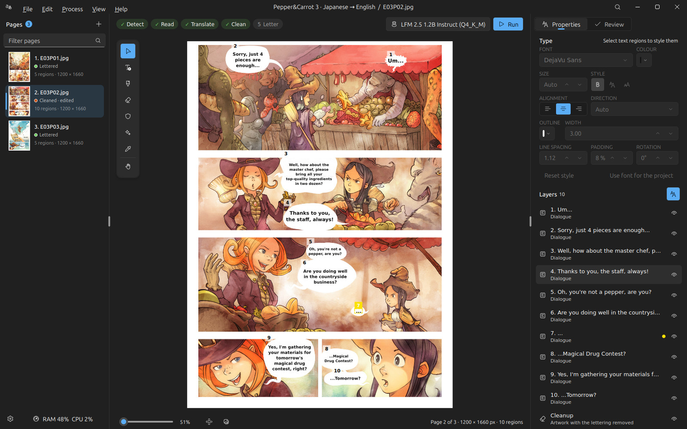
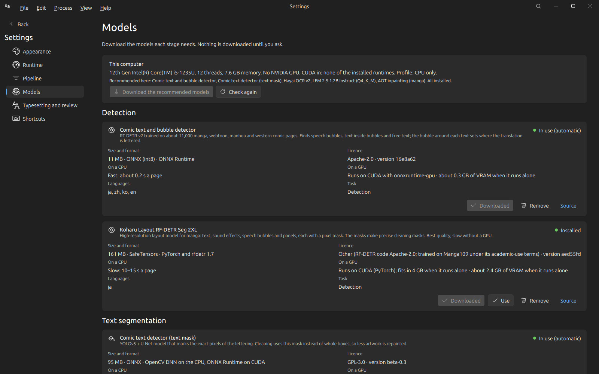
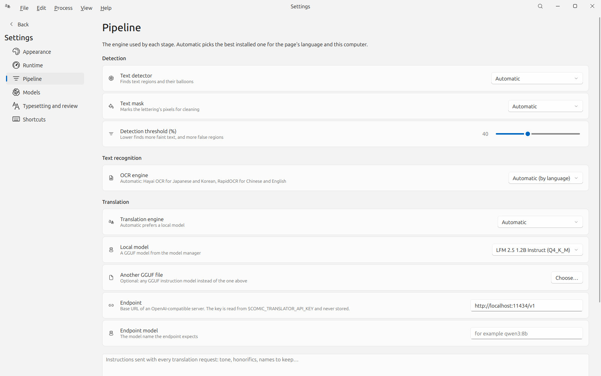

# ComicTranslator

**Translate manga, manhwa and comics on your own computer, with real models, and proofread them page by page.**
ComicTranslator detects the text and balloons, reads them, translates them with a local language model, removes the
original lettering, letters the translation back in, and gives a fast editor to check and fix every step. Its workflow
is modelled on [Koharu](https://github.com/koharu-rs/koharu); it is built with
[FluentQt](https://github.com/pntrungbk15/fluentqt-showcase) on PyQt5.


-6D28D9)

> **About this repository.** It presents ComicTranslator through screenshots and a written overview. It contains no
> source code: the application's source is private at this stage. The comic pages in the screenshots are
> *Pepper&Carrot* episode 3 by David Revoy (www.peppercarrot.com), CC BY 4.0, in its Japanese, Korean and Chinese
> editions, processed by the application on a laptop CPU; the English translations are the models' own, uncorrected.



## The workflow

```
Import ─▶ Detect ─▶ Read text ─▶ Translate ─┐
            │                               ├─▶ Letter ─▶ Review ─▶ Export
            └─────────▶ Clean ──────────────┘
```

Each page moves through the stages on its own, in warm worker processes that keep their models loaded, so the first
page can be proofread while later pages are still being read. Any stages can run on the current page, selected pages,
selected text regions or the whole project; OCR and translation results are cached, and text the user corrected is never
overwritten.

| At a glance | |
|---|---|
| **Detection** | RT-DETR comic text and bubble detector (0.2 s a page on a CPU) or Koharu's RF-DETR layout model; a segmentation model marks the lettering's exact pixels. |
| **OCR** | Hayai OCR (Japanese, Chinese, Korean, English), Manga OCR and RapidOCR, chosen per language, with a confidence per region. |
| **Translation** | Local GGUF models through llama.cpp (LFM 2.5, Qwen 3.5, Gemma 4), OpenAI-compatible endpoints or Argos; glossary, previous-page context and instructions. |
| **Cleaning** | LaMa manga and AOT (PyTorch), LaMa ONNX, OpenCV or a built-in fill, at the original resolution; brush, eraser, protect and an instant Repair brush on an undoable mask. |
| **Lettering** | Fitted to each balloon; horizontal, vertical (CJK) or right-to-left, with outline, spacing, padding and rotation. |
| **Proofreading** | A review queue across the project (missing translations, low OCR confidence, overflow, doubtful cleanup) with keyboard navigation. |
| **Runtime** | CPU first; CUDA through PyTorch, ONNX Runtime and llama.cpp; a Low VRAM profile for 4 GB GPUs that keeps one model on the GPU at a time and unloads it when its stage is done. |
| **Model manager** | Download, resume, cancel, update, remove and choose models, with source, licence, size and hardware needs, and recommendations for the detected hardware. |

## Screens

| | |
|---|---|
|  |  |
| **Start:** a new project beside the list of projects. | **Processing:** the run selector and Stop, live page states, the activity card. |
|  |  |
| **Review:** every issue in the project. | **Compare:** the original and the translation. |
|  |  |
| **Mask:** brush (red) and protect (green). | **Korean:** low OCR confidence flagged in amber. |
|  |  |
| **Chinese**, read with RapidOCR. | **Dark theme.** |
|  |  |
| **Models:** source, licence, size and hardware. | **Settings → Pipeline.** |

## Architecture

```
ui/           frameless window with a menu bar; Start, Editor and Settings views; floating tool rail and activity card
canvas/       the page editor on FluentQt Pro's image viewer: regions, masks, lettering, tools, undo
flow          one task per page and stage, dependencies, warm stage workers, GPU lifecycle policy
pipeline      the stages: what each needs, its input fingerprint, how its result is stored
engines/      detection, OCR, translation, inpainting, model catalog, hardware, cache (imported only by workers)
storage/      schema migrations and repositories
typeset       lettering shared by the editor and the export
```

The window never loads a model, so it stays responsive while pages are processed, and a crash in a native library
costs one page.

## Measured

On a laptop CPU (i5-1235U, no GPU), with the CPU defaults:

| | |
|---|---|
| Three Japanese pages, full pipeline | 86 s |
| Repair brush, one stroke | about 2 s to the rebuilt page |

## Author

Phạm Ngọc Trung · [github.com/pntrungbk15](https://github.com/pntrungbk15)

Screenshots of the application © Phạm Ngọc Trung. The comic pages shown are *Pepper&Carrot* by David Revoy,
www.peppercarrot.com, licensed CC BY 4.0, with translations by the Pepper&Carrot community. Shown here for portfolio
purposes; no licence to the software is granted by this repository.
