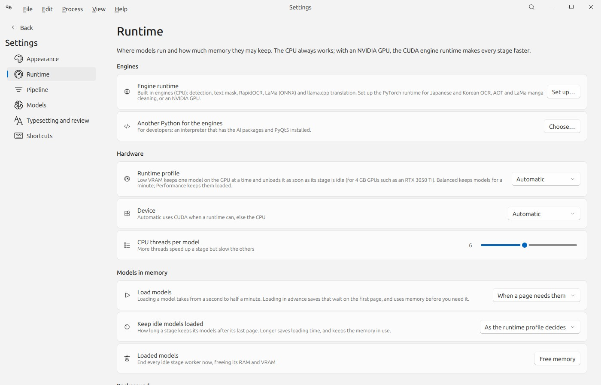
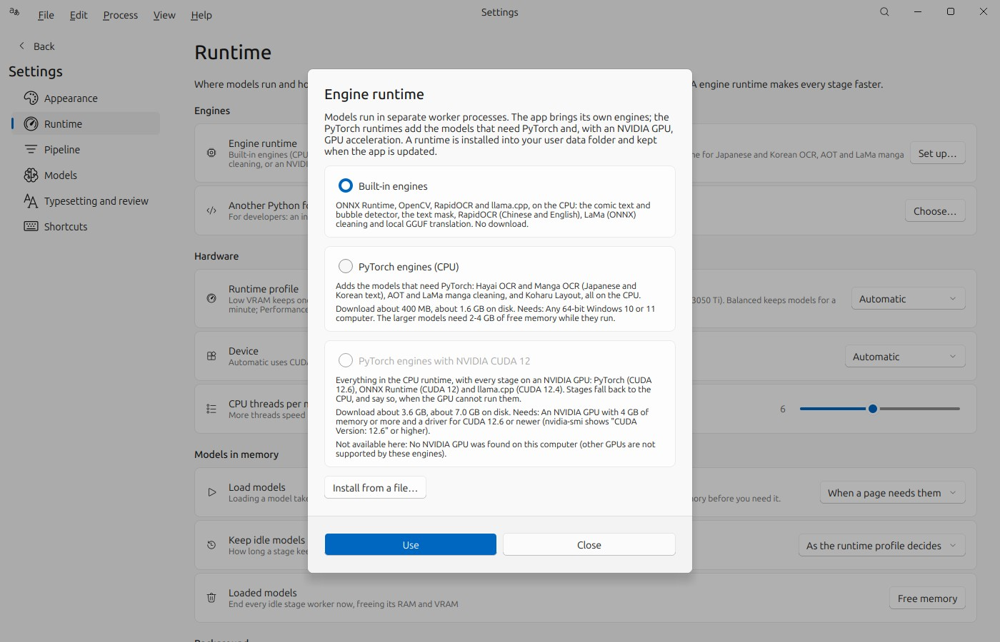
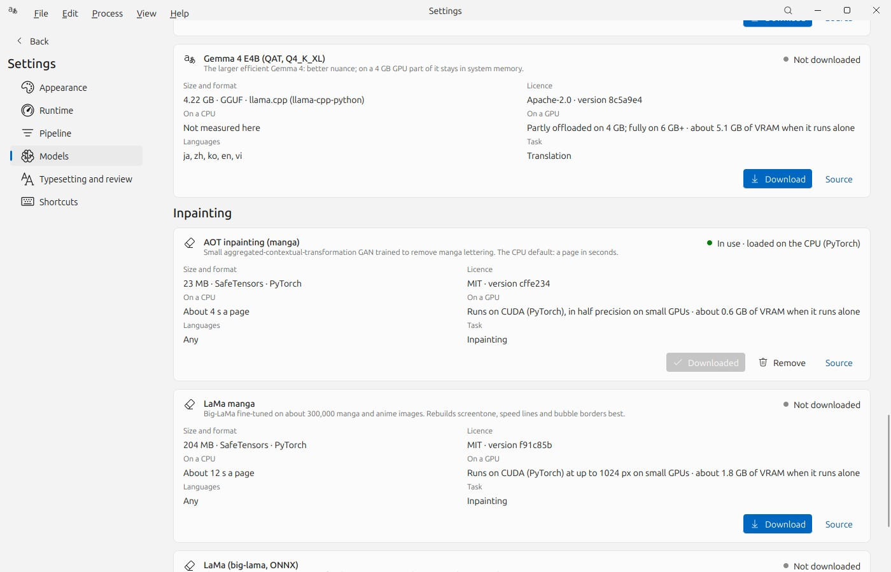

# ComicTranslator

**Translate manga, manhwa and comics on your own computer, with real models, and proofread them page by page.**
ComicTranslator detects the text and balloons, reads them, translates them with a local language model, removes the
original lettering, letters the translation back in, and gives a fast editor to check and fix every step. Its workflow
is modelled on [Koharu](https://github.com/koharu-rs/koharu); it is built with
[FluentQt](https://github.com/pntrungbk15/fluentqt-showcase) on PyQt5.


> **About this repository.** It presents ComicTranslator through screenshots and a written overview. It contains no
> source code: the application's source is private at this stage. The comic pages in the screenshots are
> *Pepper&Carrot* episode 3 by David Revoy (www.peppercarrot.com), CC BY 4.0, in its Japanese, Korean and Chinese
> editions, processed by the application on a laptop CPU; the English translations are the models' own, uncorrected.


## The workflow

```
Import ─▶ Detect ─▶ Read text ─▶ Translate ─┐
            │                               ├─▶ Letter ─▶ Review ─▶ Export
            └─────────▶ Clean ──────────────┘
```

Each page moves through the stages on its own, in warm worker processes that keep their models loaded, so the first
page can be proofread while later pages are still being read. Any stages can run on the current page, selected pages,
selected text regions or the whole project; OCR and translation results are cached, and text the user corrected is never
overwritten.

| At a glance | |
|---|---|
| **Detection** | RT-DETR comic text and bubble detector (0.2 s a page on a CPU) or Koharu's RF-DETR layout model; a segmentation model marks the lettering's exact pixels. |
| **OCR** | Hayai OCR (Japanese, Chinese, Korean, English), Manga OCR, RapidOCR (Chinese, English) and Tesseract, chosen per language, with a confidence per region. |
| **Translation** | Local GGUF models through llama.cpp (LFM 2.5, Qwen 3.5, Gemma 4), OpenAI-compatible endpoints or Argos; glossary, previous-page context and instructions. |
| **Cleaning** | LaMa manga and AOT (PyTorch), LaMa ONNX, OpenCV or a built-in fill, at the original resolution; brush, eraser, protect and an instant Repair brush on an undoable mask. |
| **Lettering** | Fitted to each balloon; horizontal, vertical (CJK) or right-to-left, with outline, spacing, padding and rotation. |
| **Proofreading** | A review queue across the project (missing translations, low OCR confidence, overflow, doubtful cleanup) with keyboard navigation. |
| **Runtime** | CPU first. CUDA paths through PyTorch, ONNX Runtime and llama.cpp, and a Low VRAM profile for 4 GB GPUs that keeps one model on the GPU at a time, are implemented and covered by profile tests but have not yet been run on an NVIDIA GPU. |
| **Model manager** | Download, resume, cancel, retry, update, remove and choose models, with source, licence, size and hardware needs, recommendations for the detected hardware and installed engines, and each model's state read from disk: downloaded, loading, or loaded, with the device and runtime it really runs on. |
| **Models in memory** | A loaded model serves every later page; models can load before the first page (on request, when a project opens, or at start-up) and stay as long as chosen. Idle stages are unloaded to make room for a stage that needs memory, and a page that runs out of memory is retried once after freeing them. |
| **Engine runtimes** | The Windows app runs ONNX Runtime, OpenCV, RapidOCR and llama.cpp by itself; the PyTorch engines (CPU, or NVIDIA CUDA 12) install from Settings in one step, with the size shown first, into the user's data folder. No Python, CUDA toolkit or compiler needed. |
| **Desktop** | A splash screen while the window builds; one running copy; an optional notification area icon that keeps processing and loaded models alive while the window is closed, with Quit that ends every worker. |

## Screens

| | |
|---|---|
|  |  |
| **Start:** a new project beside the list of projects. | **Processing:** the run selector and Stop, live page states, the activity card. |
|  |  |
| **Review:** every issue in the project. | **Compare:** the original and the translation. |
|  |  |
| **Mask:** brush (red) and protect (green). | **Korean:** low OCR confidence flagged in amber. |
|  |  |
| **Chinese**, read with RapidOCR. | **Dark theme.** |
|  |  |
| **Models:** source, licence, size and hardware for each model; the top card lists the engines that need no download and why one is not ready (here: Tesseract not installed). | **Settings → Pipeline.** |
|  |  |
| **Settings → Runtime:** the engine runtime, the hardware profile, when models load and how long idle models stay, and the notification area (disabled here: the capture ran without a desktop). | **Engine runtimes:** sizes and requirements before anything downloads; the CUDA runtime explains why it is unavailable on a computer without an NVIDIA GPU. |
|  | |
| **Downloaded vs loaded:** AOT loaded before the first page, with where it really runs ("loaded on the CPU (PyTorch)"). | |

## Models and engines

| Stage | CPU default | Alternatives |
|---|---|---|
| Detection | Comic text and bubble detector (RT-DETR-v2, int8 ONNX) | Koharu Layout RF-DETR Seg 2XL (PyTorch, `rfdetr` 1.7.0), RapidOCR text lines |
| Text mask | Comic text detector (ONNX Runtime; OpenCV DNN without it) | layout masks, an estimate inside each box |
| OCR | Hayai OCR v2; RapidOCR for Chinese and English | Manga OCR, Tesseract |
| Translation | LFM 2.5 1.2B (GGUF, llama.cpp) | Qwen 3.5, Gemma 4, any GGUF file, OpenAI-compatible endpoints, Argos Translate |
| Inpainting | AOT (PyTorch) | LaMa manga, LaMa (ONNX), OpenCV Telea, a built-in fill |

Every engine runs in a worker process and is probed there. The model manager tells apart three different problems: a
Python package that is not installed, a package that is installed but fails to load (a missing CUDA or MSVC library,
with the import error), and an external program that is missing or has no language data. A missing engine never stops
the app: *Automatic* falls back to the next engine that is ready.

## Model lifecycle

Weights are never bundled. The model manager downloads them from their sources into the user data folder:

* **State from disk.** A model is *installed* only when every file of its catalogued set is present with the catalogued
  size: Hayai OCR has eight files (including its vision encoder's configuration), Manga OCR six, and all of them are
  checked, not just the folder. The state is therefore right after a restart.
* **States:** not downloaded · downloading · incomplete (bytes kept, *Resume*) · download failed (reason shown, *Retry*)
  · files missing or out of date (*Re-download*) · installed / in use.
* **Staged, resumable, verified.** A download collects the files in a staging folder, resumes each `.part` file with HTTP
  range requests, and checks the weights against their SHA-256; a file that fails its checksum is discarded.
* **Atomic replacement.** The staging folder replaces the model's folder in one rename only when the whole set is
  complete, so a working model stays usable while a new revision downloads, and a failed or cancelled download never
  looks installed. A crash between the two renames is finished or undone on the next download. Files of a damaged copy
  whose checksum still matches are reused instead of downloaded again.

## OCR backends and what each needs

| Engine | Languages | Python packages | Outside Python |
|---|---|---|---|
| Hayai OCR v2 | ja, zh, ko, en | torch, transformers, pillow | downloaded weights |
| Manga OCR | ja | torch, transformers, fugashi, unidic-lite | downloaded weights |
| RapidOCR | zh, en | rapidocr-onnxruntime (Python 3.12 or older) | models ship inside the package |
| Tesseract | per installed language | none (pytesseract is not used) | the `tesseract` program **and** its language data |

Tesseract counts as ready only when the program runs and lists at least one language, and the app says which of the two is
missing (for example, no `jpn.traineddata` for Japanese). Installing a Python OCR package does not install Tesseract.

## Requirements and setup

The project is locked with **uv** (`pyproject.toml` + `uv.lock`, Windows and Linux). Requirements fall into four groups:

| Group | Contents | How it is installed |
|---|---|---|
| Python packages | PyQt5, NumPy, FluentQt Community and Pro; per-stage extras `detect`, `ocr`, `translate`, `inpaint`, `layout` (`rfdetr` 1.7.0 + torch), `translate-offline`; `cpu` installs every engine | `uv sync`, `uv sync --extra cpu` |
| External programs and runtimes | Tesseract and its language data, the NVIDIA driver (optional), CJK fonts, an OpenAI-compatible server (optional) | by the user, outside Python |
| Model assets | the weights of each model | the model manager |
| Optional backends | RapidOCR, Tesseract, OpenCV, Argos, endpoints, CUDA builds | an extra, an external program or a separate environment |

The base install starts the app with no AI runtime at all; the engines are added per stage. On Linux, PyTorch comes from
PyTorch's CPU index (PyPI's Linux wheels are the multi-GB CUDA builds), and llama-cpp-python from its maintainer's CPU
wheel index. Only `opencv-python` is declared: having it and `opencv-python-headless` side by side breaks `cv2`.

Verified: `uv lock --check` passes, and a sync with the `cpu` extra into an empty environment (Linux, and Windows 11,
Python 3.12) imports every engine module and passes the test suite.

## Engineering notes

* **About dialog with one button.** The Community `MessageBox` always creates an OK and a Cancel button; the app had
  passed an empty Cancel text, which left a real, blank second button that also closed the dialog. The dialog is now
  built on the bare in-window dialog base with a single *Close* button (Enter and Escape close it), and a test asserts
  it contains exactly one button.
* **Native runtime loading order on Windows.** PyQt5 ships an older MSVC runtime. Loaded after Qt, ONNX Runtime crashes
  the process and PyTorch fails with *WinError 1114 … c10.dll* (both reproduced). The workers import ONNX Runtime, and
  on Windows PyTorch, before they touch Qt.
* **OpenCV environment leakage.** `opencv-python` points Qt at its own plugins when imported; worker environments drop
  those variables before Qt starts.
* **Where a model really runs.** PyTorch, ONNX Runtime and llama.cpp each fall back to the CPU by themselves (a missing
  CUDA library, too little VRAM). Every worker therefore reads the device back from the loaded object (the session's
  first execution provider, the parameters' device, the layers llama.cpp offloaded) and reports it after each page; the
  interface shows that report, never the requested setting.
* **Engine runtimes without file locks.** On Windows a folder whose DLLs a process has loaded cannot be renamed or
  deleted, so each runtime install goes into a new folder and the old one is deleted at the next start, before any
  worker runs. The install runs in the app's own worker, never in the runtime it replaces, and cancelling it kills uv's
  whole process tree.
* **A packaging bug the smoke test caught.** In the first Nuitka build, every engine looked broken: the compiled code
  lost the `importlib.metadata` attribute that a module-level import should have provided, and the engine check raised.
  The metadata lookup is now imported where it is used and treated as optional, and the smoke test runs the packaged
  worker's engine check on every build.
* **Licences of compiled-in packages.** Nuitka compiles pure-Python packages into the executable, so scanning the build
  folder missed some, and several wheels (ONNX Runtime, PyQt5) declare their licence only in metadata. The build reads
  Nuitka's compilation report, copies each bundled package's licence files and writes a list of their declared licences.

## Windows build and installer

One command on the development computer (`deploy\build_windows.cmd`) creates a locked build environment with uv,
compiles the app with **Nuitka** into a standalone folder, checks and runs it, and packs it with **Inno Setup**:

| | |
|---|---|
| Build | Nuitka 4.2.2 standalone folder, Python 3.12, MSVC 14.4; 427 MB with the CPU engines (ONNX Runtime, OpenCV, RapidOCR, llama.cpp) |
| Installer | 108 MB; per-user (no administrator rights) or for all users; Start menu entry; updates in place; refuses to run while the app is open |
| Never bundled | PyTorch, CUDA libraries, model weights; the PyTorch engines install on request, with their size shown first |
| User data | `%LOCALAPPDATA%\FluentComicTranslator`: kept by updates and by the uninstaller (which only offers to delete the engine runtimes) |

Every build is smoke-tested before it is released: the packaged app starts, shows its window (1.7–2.8 s to the
window on the build machine) and quits; its worker reports the compiled-in engines; it processes two real pages from its
own window (loading the models first, then detect, read, translate, clean, letter, export as CBZ) with the built-in
engines and again with the PyTorch engine runtime. The installer was installed, upgraded over and uninstalled silently
in a test folder, with the user's data left in place.

## Architecture

```
ui/           frameless window with a menu bar; Start, Editor and Settings views; floating tool rail and activity card
canvas/       the page editor on FluentQt Pro's image viewer: regions, masks, lettering, tools, undo
flow          one task per page and stage, dependencies, warm stage workers and their states, memory and GPU policy
pipeline      the stages: what each needs, its input fingerprint, how its result is stored, which models it loads
enginesetup   optional engine runtimes: a standalone Python with the locked PyTorch packages, installed with uv
engines/      detection, OCR, translation, inpainting, model catalog, hardware, cache (imported only by workers)
storage/      schema migrations and repositories
typeset       lettering shared by the editor and the export
```

The window never loads a model, so it stays responsive while pages are processed, and a crash in a native library
costs one page. Start-up opens the database and builds the window behind a splash screen; models load when a page
needs them or when the user asks, never before the window is usable.

## Measured

On a laptop CPU (i5-1235U, no GPU), with the CPU defaults:

| | |
|---|---|
| Three Japanese pages, full pipeline | 86 s |
| Eight pages: first page lettered, page flow vs stage by stage | 16 s vs 43 s |
| Repair brush, one stroke | about 2 s to the rebuilt page |
| Comic text and bubble detector | 0.2 s a page |
| Koharu Layout RF-DETR Seg 2XL | 11–14 s a page |
| Comic text detector (text mask) on the CPU: ONNX Runtime with subnormals flushed to zero, vs OpenCV DNN | 1.7–2 s vs 3.3–5 s a page |
| Manga OCR / Hayai OCR v2 | 0.4 s / 0.8 s a balloon |
| LFM 2.5 1.2B (Q4_K_M) translation | 2–3 s a page |
| AOT / LaMa manga inpainting | about 4 s / 12 s a page |
| First page with the stage's models loaded in advance vs a cold stage (Hayai OCR / AOT / LFM 2.5 / detection) | 2.7 s vs 6.8 s / 2.5 s vs 3.3 s / 2.0 s vs 3.0 s / 1.9 s vs 2.4 s |
| CPU engine runtime install (download and install, Windows 11, home connection) | 482 s; 1.6 GB on disk |

## Release notes

**0.3.0** (Windows build and installer)

* Windows installer (Inno Setup) around a Nuitka standalone build that runs on a computer without Python.
* Engine runtimes: the PyTorch engines (CPU, about 400 MB to download; or NVIDIA CUDA 12, about 3.6 GB) install from
  Settings with uv into the user's data folder, from package lists locked with the project; offline install from a
  packed runtime.
* Models in memory: downloaded vs loaded states with the device each model really runs on; optional loading before the
  first page; a configurable time idle models stay; idle stages unloaded to make room; one retry after running out of
  memory.
* Splash screen, single running copy, optional notification area icon with Quit that ends every worker; notifications
  when pages finish while the window is hidden.
* First-run guidance on the start screen: which stages are ready for the user's language, and one-click actions for
  the rest.

## Known limitations

* The CUDA paths and the CUDA engine runtime have not been run on an NVIDIA GPU (the development laptop has none); the
  CUDA package list was checked to resolve on Windows. Intel and AMD GPUs are not used.
* Japanese and Korean OCR need the PyTorch engine runtime (a download); the built-in RapidOCR reads Chinese and English.
* The installer is not code-signed, so Windows SmartScreen warns on first run. Installers are not published here:
  the build includes FluentQt Pro, whose distribution terms are decided separately.
* Windows and Linux only; the Windows build was tested on Windows 11 (x64).

## Author

Phạm Ngọc Trung · [github.com/pntrungbk15](https://github.com/pntrungbk15)

Screenshots of the application © Phạm Ngọc Trung. The comic pages shown are *Pepper&Carrot* by David Revoy,
www.peppercarrot.com, licensed CC BY 4.0, with translations by the Pepper&Carrot community. Shown here for portfolio
purposes; no licence to the software is granted by this repository.
